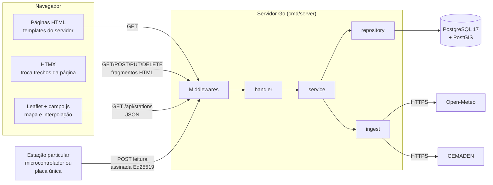
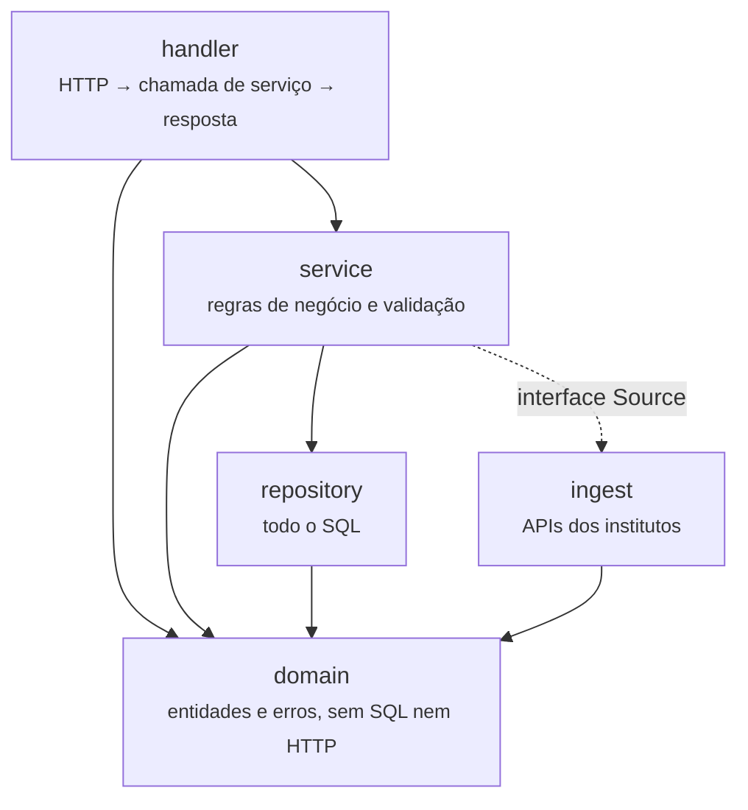
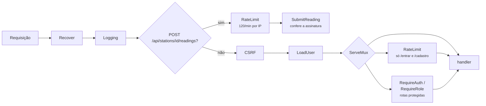
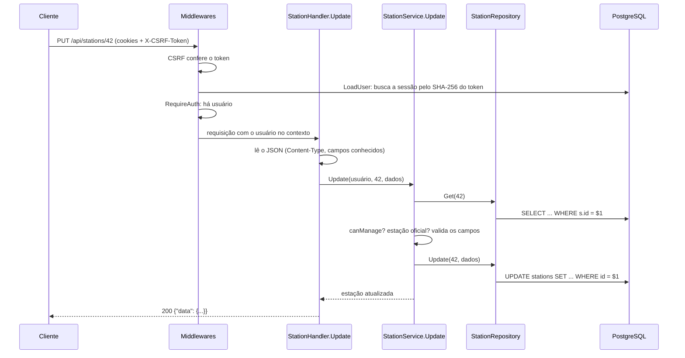
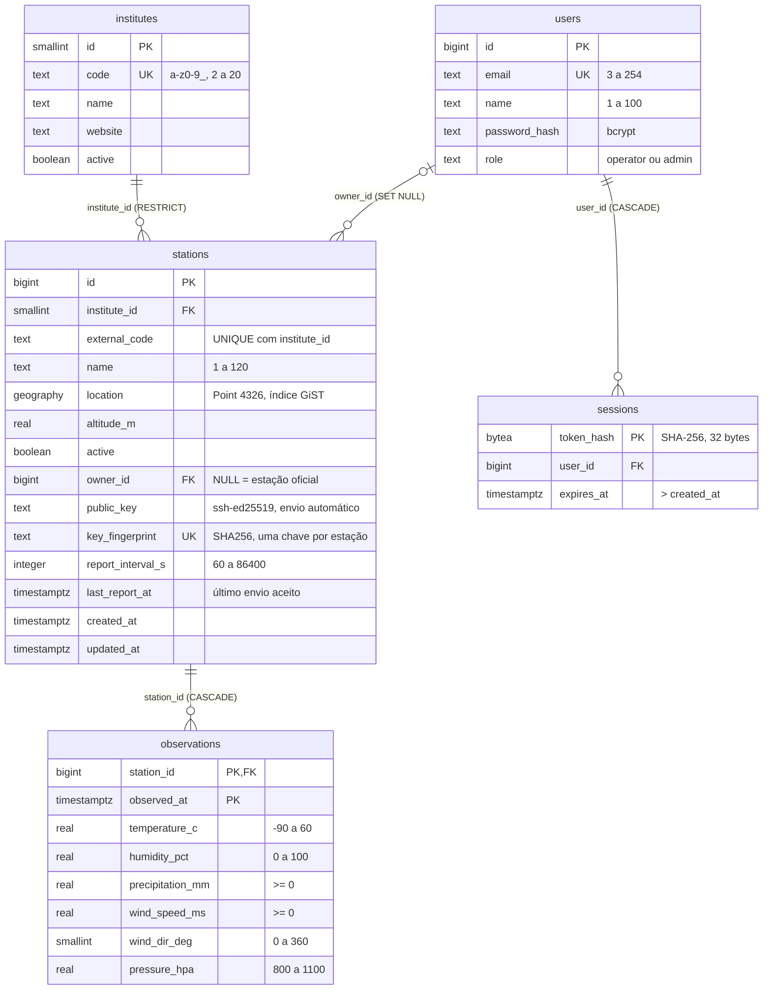
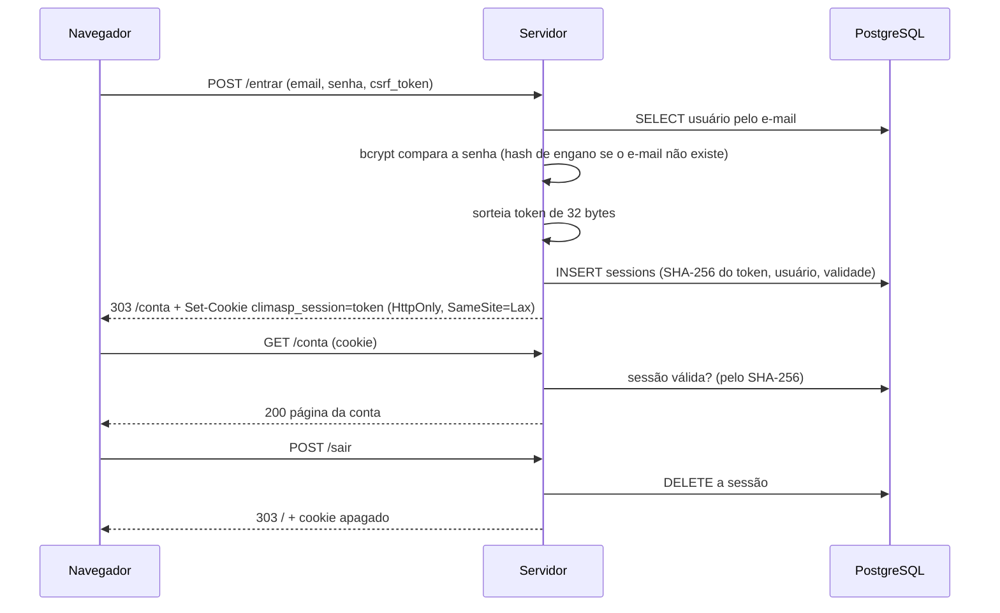
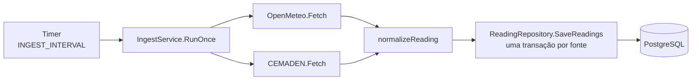
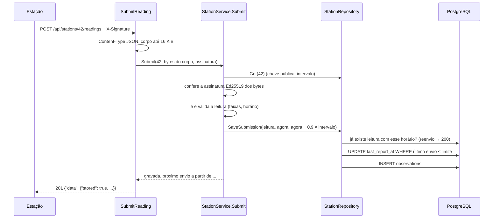

# Arquitetura do ClimaSP

Documento da arquitetura do backend e da interface do ClimaSP, o agregador de
dados meteorológicos do Estado de São Paulo. Os endpoints estão descritos em
[api.md](api.md); como executar está no [README](../README.md).

## Visão geral

O ClimaSP é uma aplicação **cliente-servidor monolítica**, escrita em Go, com
**arquitetura em camadas**. Um único processo serve as páginas HTML, os
fragmentos que o HTMX troca na página, a API JSON e os arquivos estáticos. O
mesmo código também coleta, em segundo plano, as medições dos institutos, e
recebe as leituras que as estações particulares enviam sozinhas, assinadas
com uma chave Ed25519 ([estacao-particular.md](estacao-particular.md)).



| Peça | Tecnologia | Papel |
|---|---|---|
| Servidor | Go 1.26, `net/http`, `html/template`, `log/slog` | Rotas, regras de negócio, renderização |
| Banco | PostgreSQL 17 + PostGIS 3.5 | Persistência; posição das estações em `geography(Point, 4326)` |
| Acesso a dados | pgx v5 (pool de conexões) | SQL escrito à mão, sempre com parâmetros |
| Migrações | goose | Evolução do esquema, uma migração por mudança |
| Interface | HTML do servidor, HTMX 2.0, Leaflet 1.9 | Páginas e interações sem framework JavaScript |
| Senhas | bcrypt (`golang.org/x/crypto`) | Hash das senhas, custo 12 |

### Por que um monólito em camadas

O domínio é pequeno: uma entidade principal (estação), suas medições, usuários
e sessões. Um monólito evita a complexidade de serviços separados e permite
que páginas e API compartilhem as mesmas regras. As camadas dão a separação
que o projeto exige — interface, lógica de aplicação e acesso a dados — sem a
cerimônia de uma arquitetura hexagonal completa: as interfaces existem só onde
uma camada precisa ser trocada nos testes.

## Camadas

A dependência vai sempre em uma direção: de fora para dentro.



| Camada | Pasta | Responsabilidade | Não faz |
|---|---|---|---|
| Interface | `internal/server`, `web/` | Lê a requisição, chama o serviço, escolhe o formato da resposta (JSON, página, fragmento) | Regras de negócio, SQL |
| Lógica de aplicação | `internal/service` | Validação, permissões, regras (quem edita qual estação, confiança da leitura) | HTTP, SQL |
| Acesso a dados | `internal/repository` | Consultas e gravações no PostgreSQL | Decidir o que é permitido |
| Fontes externas | `internal/ingest` | Fala com Open-Meteo e CEMADEN e converte para `domain.Reading` | Gravar no banco |
| Domínio | `internal/domain` | `Station`, `Observation`, `Reading`, `User`, erros do sistema | Depender de qualquer outra camada |
| Segurança | `internal/security` | bcrypt, tokens aleatórios, limite de tentativas, chaves Ed25519 no formato do OpenSSH | Conhecer HTTP ou o banco |
| Configuração | `internal/config` | Lê o ambiente (`.env`) | — |

### Inversão de dependência

Cada camada declara, no próprio pacote, a interface do que precisa da camada
de baixo. O serviço de estações, por exemplo, define:

```go
// internal/service/station.go
type StationRepository interface {
    List(ctx context.Context, filter domain.StationFilter, limit, offset int) ([]domain.Station, int, error)
    Get(ctx context.Context, id int64) (domain.Station, error)
    Create(ctx context.Context, ownerID int64, in domain.StationInput) (int64, error)
    Update(ctx context.Context, id int64, in domain.StationInput) error
    SetActive(ctx context.Context, id int64, active bool) error
    Delete(ctx context.Context, id int64) error
}
```

O `*repository.StationRepository` satisfaz essa interface sem saber que ela
existe. Nos testes, um repositório em memória ocupa o lugar dele, e as regras
são testadas sem banco. O mesmo vale para o handler, que declara a interface
`StationService`, e para a coleta, que declara `Source`.

As peças são montadas num único lugar, `internal/server/router.go`:

```go
stations := handler.NewStationHandler(
    service.NewStationService(repository.NewStationRepository(db), log), rd,
)
```

## Estrutura de pastas

```
.
├── cmd/
│   ├── server/main.go            Servidor HTTP (e coleta periódica, se configurada)
│   └── ingest/main.go            Coleta manual, uma vez
├── internal/
│   ├── config/                   Configuração lida do ambiente
│   ├── domain/                   Entidades e erros
│   ├── security/                 bcrypt, tokens, limite de tentativas
│   ├── repository/               SQL (pgx)
│   ├── service/                  Regras: estações, coleta, autenticação
│   ├── ingest/                   Open-Meteo e CEMADEN
│   └── server/
│       ├── router.go             Rotas e montagem das camadas
│       ├── middleware/           Recuperação, log, CSRF, sessão, perfil, limite
│       ├── handler/              Páginas, autenticação, estações (HTML e JSON)
│       └── render/               Templates, JSON e tradução de erros
├── migrations/                   Migrações goose (SQL)
├── db/                           schema.sql (gerado) e seed_dev.sql
├── tools/
│   ├── build-relevo.py           Gera o relevo a partir do SRTM30
│   └── estacao/                  Lado da estação: cliente Python, chave para microcontrolador, exemplo em C
└── web/
    ├── templates/                layouts/, partials/, pages/
    └── static/                   css/, js/, vendor/, data/, img/
```

## Caminho de uma requisição

Todas as requisições passam pela mesma cadeia de middlewares, montada em
`router.go`, de fora para dentro. A única rota que sai da cadeia do site é a
das leituras enviadas pelas estações, logo depois do log:



| Middleware | Pasta | O que faz |
|---|---|---|
| `Recover` | `middleware/middleware.go` | Transforma um `panic` em 500 e registra o erro, sem derrubar o servidor |
| `Logging` | `middleware/middleware.go` | Uma linha de log por requisição: método, caminho, status, duração |
| `CSRF` | `middleware/csrf.go` | Em POST, PUT, PATCH e DELETE, exige o token do cookie `climasp_csrf` repetido no cabeçalho `X-CSRF-Token` ou no campo `csrf_token`; limita o corpo a 1 MiB |
| `LoadUser` | `middleware/auth.go` | Lê o cookie de sessão e coloca o usuário no contexto; nunca recusa |
| `RateLimit` | `middleware/ratelimit.go` | 10 tentativas por minuto por IP em login e cadastro; acima disso, 429 |
| `RequireAuth` | `middleware/auth.go` | Exige login: navegador vai para `/entrar`, HTMX recebe `HX-Redirect`, API recebe 401 |
| `RequireRole` | `middleware/auth.go` | Exige um perfil (administrador); 403 para os outros |

Por que a rota das estações fica fora do CSRF e da sessão: o CSRF protege
credenciais que o navegador manda sozinho (cookies). Uma estação não tem
cookie, e a assinatura do corpo não é algo que outro site consiga fazer o
navegador anexar. Cada pedido é autenticado pela chave da estação, no
serviço (`internal/service/station_uplink.go`).

Exemplo completo, um operador alterando a própria estação pela API:



## Tratamento de erros

Os erros nascem nas camadas internas como valores do domínio
(`domain.ErrNotFound`, `domain.ErrForbidden`, `*domain.ValidationError`...) e
saem por um único ponto, `render.Renderer.Fail`. A tabela que traduz cada erro
em status HTTP e mensagem é a função `render.Describe`, a única do sistema.

O formato da resposta depende de quem pediu, mas o status é sempre o mesmo:

| Quem pediu | Como o servidor sabe | Formato do erro |
|---|---|---|
| HTMX | cabeçalho `HX-Request: true` | Fragmento `<p class="request-error" data-field="...">`, que a página coloca no lugar certo |
| Navegador | GET com `Accept: text/html` | Página de erro do site, com cabeçalho e menu |
| Cliente da API | qualquer outro caso | JSON `{"error": {"code", "message", "field", "detail"}}` |

Erros desconhecidos viram 500 com a mensagem genérica "Erro interno do
servidor." e são registrados no log com a causa. A causa técnica só vai na
resposta (campo `detail`) quando `APP_ENV=dev`.

## Modelo de dados



Decisões do modelo:

- **Estação oficial × particular.** `owner_id` nulo marca uma estação coletada
  de um instituto; preenchido, uma estação cadastrada no site. As
  particulares pertencem ao instituto `particular`.
- **Chaves naturais protegidas por UNIQUE.** `(institute_id, external_code)`
  impede a mesma estação duas vezes; a coleta usa essa chave no
  `ON CONFLICT` para criar ou atualizar.
- **Observações com chave composta.** `(station_id, observed_at)` impede a
  mesma leitura duas vezes, e o índice da chave serve à consulta da leitura
  mais recente (`LATERAL ... ORDER BY observed_at DESC LIMIT 1`).
- **Exclusões.** Apagar uma estação apaga as observações (`CASCADE`); um
  instituto com estações não pode ser apagado (`RESTRICT`); apagar um usuário
  mantém as estações dele, que ficam sem dono (`SET NULL`).
- **Chave da estação.** `public_key`, `key_fingerprint` e
  `report_interval_s` existem juntos ou nenhum (`CHECK`); a impressão digital
  é única, então uma chave identifica uma única estação. Só a chave pública
  é guardada.
- **Validação em dois níveis.** Os `CHECK` do banco repetem os limites do
  serviço: se uma regra falhar no código, o banco ainda recusa o dado.

As mudanças do esquema são migrações goose numeradas em `migrations/`. O
script de criação completo é `db/schema.sql`, gerado do banco por
`make schema`.

## Autenticação e sessões



- **Sessão no banco, não JWT.** Sair apaga a linha, e o cookie antigo deixa de
  valer na hora; com JWT seria preciso uma lista de revogação.
- **Só o hash do token no banco.** Quem ler a tabela `sessions` não consegue
  usar as sessões.
- **Mesma resposta para e-mail inexistente e senha errada**, e o mesmo tempo
  de resposta (um hash de engano é comparado quando o e-mail não existe).
- **Perfis.** Todo cadastro cria um operador. O primeiro administrador nasce
  no servidor, com `make promote-admin EMAIL=...`.

## Controle de acesso

A permissão é verificada em dois níveis. Os middlewares `RequireAuth` e
`RequireRole` bloqueiam rotas inteiras; as regras por estação ficam no
serviço (`internal/service/station_manage.go`), porque dependem de dados:

```go
func canManage(actor domain.User, st domain.Station) bool {
    if actor.IsAdmin() {
        return true
    }
    return st.OwnerID != nil && *st.OwnerID == actor.ID
}
```

| Ação | Visitante | Operador | Administrador |
|---|---|---|---|
| Ver mapa, lista e `GET /api/stations` | sim | sim | sim |
| Painel de estações | não | as suas | todas |
| Cadastrar estação | não | sim (fica dono) | sim (fica dono) |
| Editar ou excluir estação particular | não | só as suas | todas |
| Ativar ou desativar | não | só as suas | todas, inclusive as oficiais |
| Editar ou excluir estação oficial | não | não | não (409: os dados vêm da fonte) |
| Cadastrar a chave de envio automático | não | nas suas | nas particulares |
| Lista de usuários | não | não | sim |

Esconder um botão na página é só conveniência: toda regra é aplicada no
servidor, e os testes as exercitam por HTTP.

## Segurança

| Ameaça | Proteção | Onde |
|---|---|---|
| SQL injection | SQL sempre com parâmetros (`$1, $2...`); na busca, só os marcadores entram no texto e `%` e `_` são escapados | `internal/repository` |
| XSS | `html/template` escapa todo valor conforme o contexto (texto, atributo, URL); o JavaScript monta texto com `textContent` | `web/templates`, `web/static/js` |
| CSRF | Padrão *double submit*: cookie `climasp_csrf` + mesmo valor no cabeçalho ou no campo; `SameSite=Lax` como segunda barreira | `middleware/csrf.go` |
| Roubo de sessão por script | Cookie `HttpOnly`; `Secure` fora de `APP_ENV=dev` | `handler/auth.go` |
| Força bruta | 10 tentativas por minuto por IP em `/entrar` e `/cadastro` | `middleware/ratelimit.go` |
| Senhas vazadas | bcrypt custo 12; o banco nunca vê a senha | `internal/security/password.go` |
| Corpo gigante | 1 MiB no máximo em qualquer requisição que altera dados | `middleware/csrf.go` |
| Dados externos inválidos | Leitura fora do Estado, com data impossível ou valor fisicamente impossível é descartada | `service/ingest.go` |
| Segredos no código | Credenciais só no `.env`, que não é versionado | `internal/config` |
| Leitura forjada em nome de uma estação | Assinatura Ed25519 dos bytes do corpo, conferida com a chave pública cadastrada; o servidor não guarda segredo da estação | `service/station_uplink.go`, `security/sshkey.go` |
| Repetição de um envio capturado | A leitura fica gravada pelo horário (chave primária); repetida, não muda nada. `observed_at` só vale de 24 h atrás a 5 min à frente | `repository/station.go` |
| Estação enviando demais | Intervalo conferido e registrado no mesmo `UPDATE`, que trava a linha: dois envios simultâneos não passam juntos. Mais 120 pedidos por minuto por IP | `repository/station.go`, `router.go` |

## Coleta das fontes externas



- Cada fonte implementa a interface `service.Source` (`Code`, `Fetch`). Uma
  fonte que falha não interrompe as outras.
- `normalizeReading` descarta leituras fora da caixa do Estado, sem código,
  com mais de 48 h ou no futuro, e anula valores fisicamente impossíveis, com
  os mesmos limites dos `CHECK` da tabela.
- A gravação é um `INSERT ... ON CONFLICT` por estação e outro por leitura,
  numa transação: a fonte é gravada inteira ou nada.
- O CEMADEN exige credencial; o token (válido por cerca de 4 h) é renovado
  sozinho a partir do e-mail e da senha do `.env`.

## Envio pelas estações particulares

O outro caminho de entrada de dados é o inverso da coleta: a estação manda.



- A assinatura é conferida antes de o corpo ser lido: um pedido sem
  assinatura válida não chega a ser interpretado.
- Ao contrário da coleta, que descarta o valor impossível e fica com o resto,
  aqui um valor fora da faixa recusa a leitura inteira (400 com o campo): o
  dono precisa saber que o sensor ou o firmware está errado.
- O estado do envio (`waiting`, `ok`, `late`) é calculado na leitura, como a
  confiança: atrasada depois de dois intervalos sem envio.

## Interface

O HTML é gerado no servidor com `html/template`: cada página de
`web/templates/pages/` é combinada com o layout e os partials. O HTMX faz o
resto sem uma aplicação JavaScript:

| Interação | Como funciona |
|---|---|
| Lista de estações do mapa | `GET /estacoes` devolve os cartões; "carregar mais" troca o próprio botão pela página seguinte |
| Balão da estação no mapa | `GET /estacoes/{id}` devolve o cartão, que o Leaflet põe no balão |
| Login, cadastro, formulário de estação | `hx-post`/`hx-put`; erro vira fragmento na área de aviso, sucesso devolve `HX-Redirect` |
| Busca no painel | `GET /painel/estacoes/linhas?q=` troca as linhas da tabela e, fora de banda, a linha de status |
| Ativar e excluir no painel | A resposta é a linha nova (ativar) ou vazia (excluir), trocada no lugar da linha |

Tudo também funciona sem JavaScript: os formulários têm `action` e `method`
de verdade, e o servidor responde com a página inteira.

O mapa é a exceção: é desenhado no navegador pelo Leaflet a partir do JSON de
`/api/stations`. `campo.js` interpola as leituras numa grade com núcleo
gaussiano, ponderando cada estação pela confiança e pela idade da leitura, e
transforma o resultado em polígonos vetoriais (marching squares). O contorno
do Estado, as divisas municipais (IBGE) e o relevo (SRTM30) são arquivos
estáticos em `web/static/data/`.

## Configuração

Toda configuração vem do ambiente, carregado do `.env` (não versionado; o
modelo é `.env.example`):

| Variável | Uso |
|---|---|
| `APP_ENV` | `dev` mostra detalhes técnicos nos erros, recarrega templates e libera cookies sem HTTPS |
| `APP_ADDR` | Endereço do servidor (`:8080`) |
| `DATABASE_URL` | Conexão com o PostgreSQL |
| `INGEST_INTERVAL` | Intervalo da coleta automática (mínimo `10m`); vazio desliga |
| `CEMADEN_EMAIL`, `CEMADEN_PASSWORD` ou `CEMADEN_TOKEN` | Credenciais do CEMADEN; vazias desligam a fonte |

## Observabilidade

Os logs saem em texto estruturado (`log/slog`) na saída padrão, sempre com
data e hora:

```
time=2026-11-17T07:49:14.120-03:00 level=INFO msg="login succeeded" user_id=1 role=operator
time=2026-11-17T07:49:14.310-03:00 level=INFO msg="station created" station_id=42 user_id=1
time=2026-11-17T07:49:14.311-03:00 level=INFO msg=request method=POST path=/api/stations status=201 duration=1.9ms
```

| Evento | Mensagem | Nível |
|---|---|---|
| Login bem-sucedido | `login succeeded` | INFO |
| Falha de autenticação | `authentication failed` (com o motivo) | WARN |
| Conta criada | `user created` | INFO |
| Estação criada, alterada, ativada ou desativada, excluída | `station created`, `station updated`, `station active changed`, `station deleted` | INFO |
| Leitura recebida de uma estação | `reading received` | INFO |
| Envio recusado (assinatura, intervalo) | `submission refused` (com o motivo) | WARN |
| Coleta | `ingest finished` ou `ingest failed` | INFO / ERROR |
| Erro interno | `internal error` (com a causa) | ERROR |
| Toda requisição | `request` (método, caminho, status, duração) | INFO |

Senhas e tokens nunca aparecem nos logs. `GET /healthz` informa se o servidor
alcança o banco.

## Testes

| Camada | Arquivos | O que cobrem |
|---|---|---|
| Serviço | `internal/service/*_test.go` | Regras de estação, permissões, validação, confiança, coleta, autenticação |
| Repositório | `internal/repository/station_test.go` | Montagem do `WHERE` sem valores no SQL, escape do `LIKE` |
| Segurança | `internal/security/*_test.go` | bcrypt, tokens, limite de tentativas; chaves e impressões digitais conferidas contra o `ssh-keygen` |
| HTTP | `internal/server/handler/*_test.go` | Rotas reais com middlewares e templates, por um servidor de teste com cookies: CSRF, login, perfis, XSS, CRUD |
| Fontes | `internal/ingest/*_test.go` | Conversão das respostas dos institutos |

Os testes de HTTP trocam só o banco por repositórios em memória; todo o resto
é o código de produção. Rodam com `make test`.
